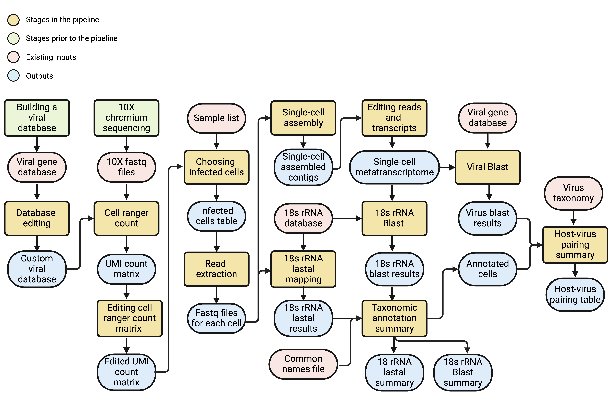

# ViHoP: Virus-Host Pairing

**ViHoP** pairs giant viruses to protist hosts from environmental single-cell 10x RNA-seq data.

> Release **v1.0-Gossenkollesee** — Gossenkollesee giant-virus reference, Alps 10x dataset reproduction bundle.



## Contents

```
ViHoP/
├── README.md
├── run_pipeline.sh
├── pairing.config.example
├── requirements.txt
├── sc_virus_host_detection_pipeline.png
├── bin/                               # Pipeline scripts used by run_pipeline.sh (20 scripts)
├── docs/
│   ├── sample_table_fastq.tsv
│   ├── sample_table_Alps.tsv
│   └── replacement_taxa.tsv
├── config/
│   ├── pairing.config.Gossenkollesee  # Config for Gossenkollesee/Alps analysis
│   ├── pairing.config.Alps
│   └── pairing.config.Alps.full18s
└── example_outputs/
```

## Prerequisites

### Software

1. **Conda environment** (Python 3.10):

```bash
conda create --name vihop --file requirements.txt
conda activate vihop
```

2. **External tools** (installed via LSF modules in the original run; install via conda or system packages if needed):

| Tool | Version used | Purpose |
|------|-------------|---------|
| CD-HIT | 4.6.6 | Viral gene deduplication |
| Cell Ranger | 10.0.0 | 10x count matrix generation |
| seqtk | — | FASTQ manipulation |
| TrimGalore | 0.6.5 | Read trimming |
| SPAdes | 3.15.3 | Per-cell RNA assembly |
| BBMap (bbduk) | — | Low-complexity filtering |
| BLAST+ | 2.11.0 | 18S rRNA search |
| LAST (lastal, lastdb) | 1574 | Viral protein & 18S alignment |
| barrnap | — | rRNA extraction from contigs |

Module load commands are set in `pairing.config`; adjust for your cluster.

### Reference databases

Download and index before running:

| Database | Source | Used for |
|----------|--------|----------|
| Viral gene FASTA | Project-specific (e.g. Gossenkollesee metagenome genes) | Cell Ranger reference, infection detection |
| PR2 v5 | [pr2-database.org](https://pr2-database.org/) | Host 18S BLAST/lastal |
| metaPR2 v2 | [metapr2.org](https://app.metapr2.org/metapr2/) | Host 18S BLAST |
| Giant virus proteins | e.g. [GVDB](https://faylward.github.io/GVDB/) | Viral lastal |
| RefSeq viruses (masked) | Used for false-positive filtering in viral search | `lastal_search_viruses.sh` |
| Virus taxonomy CSV | Family-level classification of virus contigs | Host–virus pairing summary |

Build BLAST databases:

```bash
makeblastdb -in PR2.fasta -dbtype nucl -out pr2_v5
makeblastdb -in metaPR2.fasta -dbtype nucl -out metapr2_v2
lastdb -c -P 4 pr2_v5 PR2.fasta
lastdb -c -p -P 12 virus_last_db virus_proteins.faa
```

### Input data

- **10x Chromium FASTQ files** (dual-lane supported)
- Tab-delimited **sample table** (`docs/sample_table_fastq.tsv`): one row per sample with columns `sample_name<TAB>fastq_path`

## Setup

1. Create a working directory and copy this package:

```bash
cp -r ViHoP_submit /path/to/ViHoP_workdir
cd /path/to/ViHoP_workdir
```

2. Create your config from the template:

```bash
cp pairing.config.example pairing.config
# Edit pairing.config: set WD, database paths, FASTQ paths, queue names
```

For the Gossenkollesee/Alps analysis reproduced in this release, use `config/pairing.config.Gossenkollesee` (taxonomic level `Order`, `ANNOTATION_METHOD=blast`, `VIRUS_IDENTITY=70`).

3. Update `docs/sample_table_fastq.tsv` with your sample names and FASTQ paths.

## Running the pipeline

The pipeline is designed for **LSF** job submission (`bsub`). Each stage can be toggled independently via `RUN_*` flags in `pairing.config`.

```bash
conda activate vihop
sh run_pipeline.sh
```

### Recommended: run stage by stage on first execution

Set all `RUN_*=false` except the stage you want, then enable stages sequentially as outputs appear.

| Stage | Config flag | Key inputs | Key outputs |
|-------|-------------|------------|-------------|
| 1. Database editing | `RUN_DB_EDIT` | Viral gene FASTA | `All_MetaG_CR/` Cell Ranger reference, `*.final.fasta`, `*.gtf` |
| 2. Cell Ranger count | `RUN_CELL_RANGER` | Reference, FASTQs | `{sample}/outs/filtered_feature_bc_matrix/` |
| 3. Matrix editing | `RUN_READ_MTX` | Count matrices | `Combined_RAW/data_raw.pickle.gz` |
| 4. Choose infected cells | `RUN_FIND_INFECTED` | Combined matrix, sample table | `list_cells.tsv` |
| 5. Read extraction | `RUN_EXTRACT_READS` | `list_cells.tsv`, FASTQs | `assemble_first_cells/all_cells/{cell}/` |
| 6. Assembly | `RUN_ASSEMBLE_CELLS` | Per-cell reads | `assemble_first_cells/all_cells/{cell}/assembly/transcripts.fasta` |
| 7. Read editing | `RUN_READ_EDITING` | Per-cell FASTQs | `{cell}_combined.fq.gz` |
| 8. Transcript editing | `RUN_TRANSCRIPTS_EDITING` | Assembled transcripts | `assemble_first_cells/all_cells.transcripts.final.fasta` |
| 9. Host 18S BLAST | `RUN_BLAST` | Combined transcripts, PR2/metaPR2 | `blast_results/all_cells.rRNA.PR2.tsv` |
| 10. Host 18S lastal | `RUN_18S_LAST` | Combined reads, PR2 | `mapped_cells_18s/` |
| 11. Cell annotation | `RUN_CELL_ANNOTATION` | BLAST/lastal results | `blast_summary.{Level}.csv`, `last_summary.{Level}.csv`, `summarized_annotation.{Level}.csv`, `total_cells.list` |
| 12. Viral lastal | `RUN_VIRAL_LAST` | Combined transcripts, virus DB | `mapped_cells_virus/summary_last_combined.tsv` |
| 13. Host–virus pairing | `RUN_VIRAL_SUMMARY` | Viral hits + host annotation | `summary_blast_viruses.{Level}.tsv` |

## Key output files

| File | Description |
|------|-------------|
| `summary_blast_viruses.Order.tsv` | Final host–virus pairing table (contig, virus family, host cell, host taxonomy) |
| `blast_summary.Order.csv` | Per-cell host annotation from 18S BLAST |
| `last_summary.Order.csv` | Per-cell host annotation from 18S lastal |
| `summarized_annotation.Order.csv` | Combined non-chimeric host annotations |
| `total_cells.list` | Barcodes of annotated cells (one per line: `{barcode}.{sample}`) |
| `virus_contigs.txt` | List of viral contig identifiers |
| `mapped_cells_virus/summary_last_combined.tsv` | Filtered viral lastal hits |

Preview files are in `example_outputs/`.

## Alps analysis parameters

The Alps run used these settings (see `config/pairing.config.Alps`):

- **Samples**: Alps2, Alps5, Alps_Amir
- **Viral reference**: Gossenkollesee combined genemark/metaeuk genes (98% CD-HIT dedup)
- **Host annotation level**: Order (`TAXONOMIC_LEVEL=Order`)
- **Host BLAST filters**: ≥98% identity, ≥300 bp alignment
- **Chimeric threshold**: 100% (single dominant taxon required)
- **Viral search**: lastal against Gossenkollesee GV proteins; identity ≥70%, length ≥30
- **Pairing method**: `ANNOTATION_METHOD=blast` (host annotation from BLAST only)
- **18S lastal**: disabled (`RUN_18S_LAST=false`)

## Config note

`run_pipeline.sh` expects `RUN_READ_MTX` and `RUN_FIND_INFECTED` (not `RUN_CHOOSE_CELLS`). The template `pairing.config.example` includes all variables required by the script. If using the Alps config files directly, add these lines:

```bash
RUN_READ_MTX=true
RUN_FIND_INFECTED=true
CORES_MTX=1
MEM_MTX=1024
DIRS_LIST="Alps2,Alps5,Alps_Amir"
SUM_UMI=1
GENE_COUNT=1
MAX_UMI=1
```

## Standalone script usage

Individual scripts can be run outside the full pipeline:

```bash
# Choose infected cells
python bin/choose_cells.py \
  --data_dir Combined_RAW/ \
  --sample_table docs/sample_table_fastq.tsv \
  --output_folder Combined_RAW/ \
  --sum 1 --count 1 --exp 1

# Summarize host annotations
python bin/summarize_annotations.py \
  --last_path last_summary.Order.csv \
  --blast_path blast_summary.Order.csv \
  --cell_path total_cells.list \
  --count_reads 20 --percent 100 --level Order

# Host–virus pairing summary
python bin/blast_viruses_summary.py \
  --output_path . \
  --method blast \
  --output_name summary_blast_viruses.Order.tsv \
  --taxa_file /path/to/virus_taxonomy.csv \
  --blast_file mapped_cells_virus/summary_last_combined.tsv \
  --annotation_file blast_summary.Order.csv \
  --threshold 100 --taxa Order \
  --identity 70 --length 30
```

## Computational requirements

- **Cluster**: LSF with `bsub`/`bjobs` (adapt `run_pipeline.sh` for SLURM/PBS if needed)
- **Memory**: Cell Ranger count ~288 GB per job (48 cores × 6 GB); SPAdes ~2 GB per cell; BLAST summary scales with result size
- **Storage**: Intermediate per-cell assemblies and FASTQs can reach terabytes; set `DELETE_TMP=true` to remove intermediates after successful runs
- **Runtime**: Full Alps dataset (3 samples, ~10k cells) requires days to weeks depending on cluster load

## Citation

If you use ViHoP, please cite the associated publication and the upstream tools (Cell Ranger, SPAdes, PR2, LAST, etc.).

## Contact

amir.fromm@weizmann.ac.il
