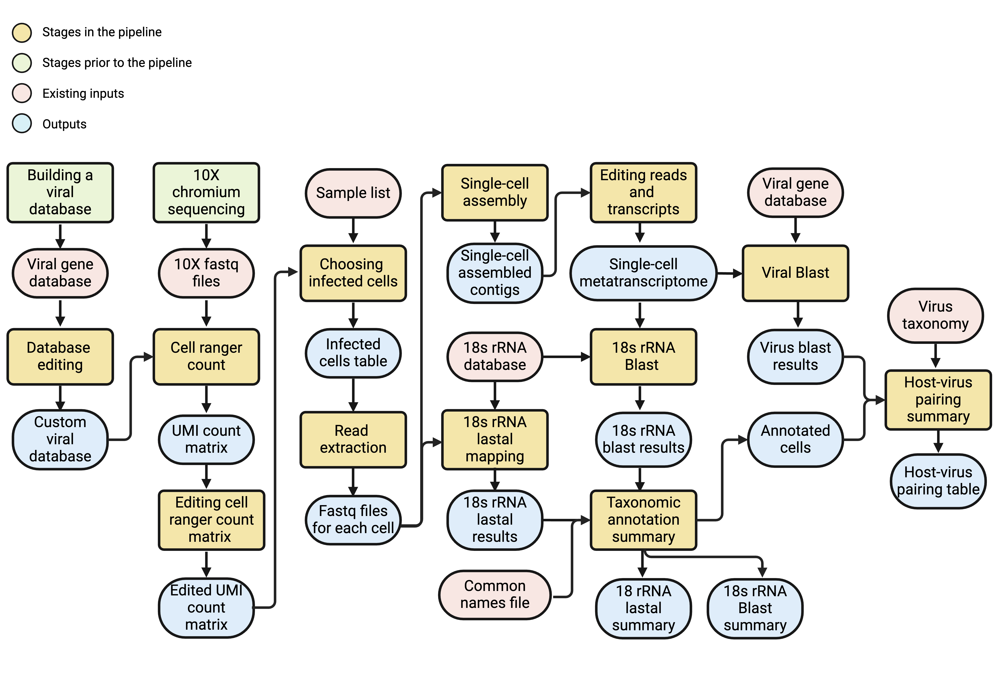

# ViHoP: Virus-Host Pairing

A pipeline that pairs viruses to their hosts from environmental 10x single-cell RNA-seq.

amir.fromm@weizmann.ac.il

It maps reads with Cell Ranger, keeps cells from the filtered matrices, assembles each cell with rnaSPAdes, assigns hosts from 18S (barrnap, then BLAST against PR2 and metaPR2), and searches the same transcripts for viruses with DIAMOND. The last step joins host and virus calls into one table.

Jobs run on LSF. Start them with `./vihop` from a login node. The controller stays in that shell and prints progress.



## Layout

The git checkout is the install. Results go in a work directory, which can be the checkout or a separate folder.

```text
install (this repo):   .../ViHoP          Snakefile, ./vihop, scripts, example config
work directory:        .../snakemake_vihop   results/, logs/, .snakemake/, your config.yaml
```

`./vihop` always loads scripts from the install (the directory that contains `./vihop`). Relative paths in the config are resolved from the work directory. If those two directories differ, write absolute paths for the sample table, the replacement file, reference databases, and any Cell Ranger override JSON.

`config/config.yaml` is the annotated example. `config/config_metat_eilat.yaml` is a worked example that points at a prebuilt Cell Ranger reference and a separate work directory. Large references are described in [docs/HUGE_REF_CELLRANGER.md](docs/HUGE_REF_CELLRANGER.md).

## Installation

```bash
git clone https://github.com/amir-fromm/ViHoP.git
cd ViHoP
conda create --name host-virus-pairing --file requirements.txt -c conda-forge -c bioconda
conda activate host-virus-pairing
```

On our cluster the workflow also loads these modules when the matching binary is not already on `PATH`. Names can differ; several wrappers try a specific module and then a short name.

```text
CellRanger/10.0.0 or cellranger/10.1.0
SPAdes/3.15
TrimGalore/0.6.5
BLAST/2.11.0
BBMap
seqtk
CD-HIT/4.6.6          only if params.reference.dedup_method is cdhit
MMseqs2               only if params.reference.dedup_method is mmseqs
barrnap               if it is not in the conda env
```

DIAMOND is not loaded as a module. Set `references.diamond_bin` to the executable.

You also need the reference files in the next section. Build them once and point the config at the products.

## Running

From the work directory, with the conda env active:

```bash
./vihop -n                          # dry-run, config from this directory
./vihop --jobs 8
./vihop --downstream                # only this stage, ignoring config toggles
./vihop --virus_search              # virus DIAMOND only (needs barrnap batches)
```

From anywhere, pointing at another work directory and config:

```bash
/path/to/ViHoP/vihop \
  --workdir /path/to/project \
  --configfile /path/to/ViHoP/config/config_metat_eilat.yaml \
  -n
```

Config lookup when you omit `--configfile`: `$WORKDIR/config.yaml`, then `$WORKDIR/config/config.yaml`, then `config/config.yaml` in the install.

| Flag | Effect |
|---|---|
| `-n` | Show the job list. Does not submit. |
| `--jobs N` | Cap concurrent LSF jobs. The profile default is 200. Use `1` for a huge Cell Ranger reference. |
| `--workdir DIR` | Where `results/`, `logs/`, and `.snakemake/` are written. Default is `$PWD`. |
| `--configfile FILE` | Config to use. A relative path is tried in the work directory, then in the install. |
| `--bam-root DIR` | Parent of `<sample>/outs/`. Overrides `references.bam_root`. |
| `--reference` `--cellranger` `--choose_cells` `--downstream` `--virus_search` | Run only the named stages. `--virus-search` is accepted as an alias. |
| `--virus_search` | Virus DIAMOND only, targeting `outputs.viral_contigs`. Splits `outputs.combined_transcripts` (no `contig_length` cutoff). Does not re-run host BLAST, pairing, assembly, or Cell Ranger. Clears virus summary + `work/` first (keeps finished `parts/` and marker `*.dmnd`) so a protected summary cannot block rebuild and missing batches resume. Full wipe: `rm -rf results/virus` then `--virus_search`. A dry-run does not delete. With `--downstream` as well, full downstream runs as usual. |
| `--annotation --bp N` | Host detection for transcripts of length N. Sets `contig_length` and `blast_length` to N, then runs the length filter, Barrnap, PR2, metaPR2, and the host summary. The same `--bp` again keeps finished batches and runs only missing ones. A different N replaces that search. Does not run virus, pairing, assembly, or Cell Ranger. Keeps existing summary CSVs and `results/host/qc`. A dry-run does not delete. |
| `--tax_level RANK` | With `--annotation`, summarize at this rank (`Genus`, `Class`, …). Default is `taxonomy.level` in the config. |
| `--split_fasta N` | Override `params.host.split_fasta`. Barrnap/BLAST split the length-filtered transcripts. Virus DIAMOND splits the combined transcripts. Alias: `--split-fasta`. With `--virus_search`, re-splits the virus batches on disk when N differs. |
| `--overwrite-downstream` | Delete extraction, assembly, host, virus, and pairing results, including `results/finished/steps.yaml`, then continue. Extraction is forced again even if a cell folder still contains assembled contigs. Cell lists, Cell Ranger, and the reference are kept. A dry-run does not delete. |
| `--bg` | Detach. Log is `logs/vihop_<timestamp>.out`. |

If both `choose_cells` and `downstream` are on, `./vihop` runs two passes. The first writes `results/candidate_cells.tsv`. The second reads that file and expands one extraction job per cell. A single Snakemake parse cannot do both, because the cell list has to exist first.

Ctrl-C on the controller runs `bkill` on the LSF jobs it submitted. Leave a live `./vihop` alone if those jobs should keep running. Do not start a second `./vihop` on the same work directory while the first is still submitting: both will send the same batch jobs.

Logs of each invocation are `logs/vihop_<timestamp>.out` in the work directory.

## Filling the config

Copy `config/config.yaml` to the work directory (or pass `--configfile`) and edit the blocks below. Paths may be absolute. A relative path is relative to the work directory, except `taxonomy.replacement_file` when it is relative: that one is read from the ViHoP install. Use an absolute replacement path when the work directory is not the install.

Turn stages on one at a time the first time you run a project. Later stages expect the files named under `outputs`.

### `input`

| Key | What to put |
|---|---|
| `sample_table` | Tab-separated file, no header: `sample_id<TAB>fastq_dir`. Several 10x runs of the same sample are one field with commas between directories. Cell Ranger merges them. See `docs/sample_table_fastq.tsv`. |
| `samples` | List of `sample_id` values to run. `null` or omitting the key runs every row of the sample table. |

### `references`

| Key | What to put |
|---|---|
| `bam_root` | Directory whose children are `<sample>/outs/` from Cell Ranger. `null` means `results/cellranger` in the work directory. `./vihop --bam-root` overrides this. Downstream read extraction uses the BAM and barcode files under `outs/`. |
| `transcriptome_fasta` | FASTA of genes or transcripts used to build the Cell Ranger reference. |
| `cellranger_transcriptome_fasta` | Same FASTA if you want the reference build to start from a copy. Point both at the file you actually want indexed. |
| `cellranger_ref_name` | Name passed to `cellranger mkref`. It becomes the directory name under `results/ref/`. |
| `pr2_fasta` | PR2 nucleotide FASTA (v5). Used if you build the BLAST database yourself. |
| `pr2_db` | `makeblastdb -dbtype nucl` prefix for PR2. Every 18S sequence is searched here first. |
| `metapr2_db` | BLAST nucleotide prefix for metaPR2 (v2). Every 18S sequence is searched here, as well as in PR2. |
| `virus_db_fasta` | Protein FASTA of virus marker genes. The pipeline runs `diamond makedb` and writes `results/virus/<stem>.dmnd`, where `<stem>` is the FASTA file name without `.faa` / `.fasta` / `.fa` (and optional `.gz`). |
| `general_diamond_db` | DIAMOND database (`.dmnd`) of a general protein reference that includes RefSeq viruses. Marker hits are searched here, and only hits whose NCBI division is Viruses are kept. |
| `refseq_catalog` | RefSeq taxid catalog (`RefSeq-release*.taxid.catalog`). |
| `refseq_nodes` | NCBI `nodes.dmp`, short form. |
| `refseq_merged` | NCBI `merged.dmp`, edited form used by `summarize_diamonds.py`. |
| `diamond_bin` | Absolute path to the `diamond` binary. |
| `virus_taxonomy` | CSV. First column is a virus name or a substring of the reference contig; second column is the taxon printed in the pairing table. |

Build the host BLAST databases once:

```bash
makeblastdb -in PR2.fasta -dbtype nucl -out pr2_v5
makeblastdb -in metaPR2.fasta -dbtype nucl -out metapr2_v2
```

Build the general virus DIAMOND database once (`diamond makedb --in REF.faa --db refSeq_viruses`). The marker database is built by the pipeline.

### `taxonomy`

| Key | What to put |
|---|---|
| `replacement_file` | TSV with header `level, old_name, new_name, color`. `level` is the PR2 rank of `old_name` (for example `Supergroup`). Matching taxa are rewritten to `new_name` in the annotation tables. `color` is stored for plotting. See `docs/replacement_taxa.tsv`. An absolute path is used as written. |
| `level` | Rank to summarize at, for example `Class`. This string is also part of the summary filenames. |

### `params.stages`

Each value is `true` or `false`. A CLI flag such as `--downstream` replaces this block for that invocation and runs only the stages you named.

| Stage | Turn on when |
|---|---|
| `reference` | You still need to deduplicate the transcriptome and run `cellranger mkref`. Leave `false` if `outputs.cellranger_ref` already points at a finished reference and `outputs.cellranger_ref_done` is an existing file (`reference.json` or `mkref.done`). |
| `cellranger` | FASTQs should be counted against that reference. |
| `choose_cells` | Cell Ranger `outs/` exist and you want `results/candidate_cells.tsv`. |
| `downstream` | `candidate_cells.tsv` exists. Extraction, assembly, 18S, virus search, and pairing. |
| `virus_search` | Barrnap batch FASTAs already exist and you want to rebuild only the virus DIAMOND search (`viral_contigs`). Prefer `./vihop --virus_search`, which clears the summary/`work/` and resumes missing `parts/`. |

Recommended order for a new project: `reference`, then `cellranger`, then `choose_cells`, then `downstream`. Use `--virus_search` later to redo virus without touching host.

### `params.cellranger`

| Key | What to put |
|---|---|
| `threads` | Slots for each `cellranger count` job. LSF memory is `resources.cellranger.mem_mb / threads` per slot. |
| `module` | `module load` name, for example `cellranger/10.1.0`. Empty uses `CellRanger/9.0.0`. |
| `localmem_gb` | Passed as `--localmem`. Set this to `mem_mb / 1000` so Cell Ranger plans from the LSF reservation. `null` derives it from `mem_mb`. |
| `localvmem_gb` | `--localvmem`. Give STAR headroom above `localmem_gb` (the Eilat config uses 240 when localmem is 160). `null` omits the flag. |
| `overrides_json` | Martian overrides file. Required for a transcriptome of tens of GB, because the default ALIGN chunk cap is too small. Empty omits it. See `config/cellranger_align_mem_expressed.json` and `config/cellranger_align_mem_huge.json`. |
| `force_clean` | `true` deletes that sample's pipestance before count. `false` resumes. Use `true` only to drop a stuck run. |
| `create_bam` | Keep `true`. Downstream extraction reads the BAM. |
| `chemistry` | `auto`, or a Cell Ranger chemistry name. |
| `expect_cells` | Integer passed as `--expect-cells`, or `null` to let Cell Ranger estimate. |

### `params.reference`

| Key | What to put |
|---|---|
| `dedup_method` | `mmseqs`, `cdhit`, or `none`. `none` means the FASTA is already deduplicated; the workflow still cleans headers, writes a GTF, and runs `mkref`. |
| `dedup_identity` | Clustering identity, for example `0.95`. |
| `mmseqs.coverage`, `cov_mode`, `min_aln_len`, `threads` | MMseqs2 linclust settings. Used only when `dedup_method` is `mmseqs`. |
| `cdhit.threads` | Threads for CD-HIT. Used only when `dedup_method` is `cdhit`. |
| `mkref_threads` | Threads for `cellranger mkref`. |

### `params.choose_cells`

| Key | What to put |
|---|---|
| `min_umi` | Minimum UMIs per barcode. `null` keeps every barcode in `filtered_feature_bc_matrix`. |
| `min_genes` | Minimum genes detected. `null` does not filter on genes. |

The table is `barcode<TAB>sample`, one row per kept cell, at `outputs.candidate_cells`.

### `params.extraction`, `assembly`, `aggregation`

| Key | What to put |
|---|---|
| `extraction.threads` | Threads for pulling one cell's reads out of the BAM. |
| `assembly.cells_per_batch` | How many cells share one LSF job. |
| `assembly.threads` | How many rnaSPAdes processes run at once inside that job. |
| `aggregation.entropy` | Complexity filter on transcripts before they are combined. |
| `aggregation.threads` | Threads for the combine step. |

### `params.host`

18S search. Barrnap and BLAST run in `split_fasta` parallel jobs on transcripts longer than `contig_length`. Virus DIAMOND uses its own splits of the combined transcripts, including the short ones.

| Key | What to put |
|---|---|
| `contig_length` | Minimum transcript length kept before barrnap. Not applied to the virus search. |
| `split_fasta` | Number of FASTA splits. Barrnap uses the length-filtered transcripts; virus uses the combined transcripts. 40 is the default. Prefer `./vihop --split_fasta N`. Older configs may still use `barrnap_batches`. Changing it after a finished run changes the job graph. |
| `barrnap_threads` | Threads per barrnap job (`cmsearch`). 4 is safe under 16 GB. 32 or 64 is fine when memory scales (see below). |
| `barrnap_kingdom` | `fun` for barrnap 1.x. That is the eukaryotic SSU model (`euk` was renamed to `fun`). |
| `blast_evalue` | BLASTN e-value against PR2 and metaPR2. |
| `blast_threads` | Threads per BLAST job. |
| `blast_identity`, `blast_length` | A hit at or above both cutoffs can assign an 18S. The summary applies the same cutoffs to PR2 and metaPR2. |
| `force_annotation` | Default `true`. A real genus beats a placeholder (`*_X`, Unknown diatom) even at a lower bitscore, and placeholder contigs are dropped when the cell has a real genus. `false` keeps the highest bitscore and only drops Unknown diatom beside another taxon. |
| `blast_prefilter_pident`, `blast_prefilter_length` | Kept for older configs. The summary streams the merged table and writes `filtered.rRNA.*.tsv` at `blast_identity` and `blast_length`, then loads that smaller table. |
| `summary_threads` | Threads for the taxonomy summary. |
| `chimeric_percent` | A cell is kept when at least this percent of its assigned 18S support agrees on one taxon. |

### `params.virus`

| Key | What to put |
|---|---|
| `identity` | Minimum percent identity when pairing a virus hit to a cell. |
| `length` | Minimum alignment length for that pairing filter. |

Each batch is `diamond blastx` (`--very-sensitive`, e-value `0.001`, one target) against the marker database (`virus_db_fasta`), then `blastx` of those candidates against `general_diamond_db`. Queries whose best general hit is non-viral are dropped. Marker and general hits are then pooled and the best bitscore wins (same as the older LASTAL search): a stronger marker/verified hit keeps that subject id; otherwise the general hit is kept.

### `resources`

Most stages still use total `mem_mb` (LSF requests `mem_mb / threads` per slot). **Virus** batch jobs use `resources.virus.cpus` and `resources.virus.memory_per_slot` (MB). LSF gets `-n cpus`, `rusage[mem=memory_per_slot]`, and `span[ptile=cpus]` (`-n` equals `ptile` so slots stay together). Defaults: 16 × 750 MB = 12 GB total. A single DIAMOND reference block peaked near 5.2 GB.

`disk_mb` is scratch. `runtime` is minutes. `lsf_queue` is a role, `short` or `long`. The scheduler names for those roles are `lsf.queues.short` and `lsf.queues.long`. On Wexac both are `short` and `long`. On another cluster, change those two names and leave the roles as they are. A multi-day Cell Ranger count uses the `long` role.

Host barrnap memory is `max(barrnap_mem_mb, barrnap_threads × barrnap_mem_mb_per_thread)`. Defaults: floor 16000 MB, 3000 MB per thread (from ~12 GB peak at 4 threads). So 32 threads reserve 96 GB and 64 threads reserve 192 GB. Raising threads without enough RAM causes `TERM_MEMLIMIT` (64 threads under 16 GB failed that way). Override `resources.host.barrnap_mem_mb_per_thread` if a site needs a different ratio.

Cell Ranger against a ~30 GB transcriptome needs on the order of 160 GB (`mem_mb: 160000`, 8 threads, `--localmem 160`). Details and the pilot checks are in [docs/HUGE_REF_CELLRANGER.md](docs/HUGE_REF_CELLRANGER.md).

### `outputs`

Paths are relative to the work directory unless you write an absolute path. Point `cellranger_ref` and `cellranger_ref_done` at a prebuilt reference when `params.stages.reference` is false. `cellranger_ref_done` must be a real file, usually `reference.json`.

| Key | Default | Contents |
|---|---|---|
| `candidate_cells` | `results/candidate_cells.tsv` | Cells to extract and assemble. |
| `cells_dir` | `results/cells` | Per-cell reads and assemblies. |
| `cellranger_ref` | `results/ref/<name>/<name>` | `cellranger mkref` directory. |
| `cellranger_ref_done` | `results/ref/<name>/mkref.done` | Stamp, or `reference.json` of a prebuilt ref. |
| `combined_transcripts` | `results/assembly/all_cells.transcripts.final.fasta` | All cells, one FASTA. |
| `rrna_18s` | `results/host/18S.rrna.fasta` | 18S sequences from barrnap. |
| `blast_pr2` | `results/host/all_cells.rRNA.PR2.tsv` | Merged PR2 BLASTN table. |
| `blast_metapr2` | `results/host/all_cells.rRNA.metaPR2.tsv` | Merged metaPR2 BLASTN table. |
| `cell_annotation_blast` | `results/host/blast_summary.{level}.csv` | Host summary. Kept next to the BLAST tables. `./vihop --annotation --bp N` writes `blast_summary.{level}.{N}.csv`. |
| `cell_annotation_final` | `results/host/summarized_annotation.{level}.csv` | One host call per cell. The annotation rerun writes `summarized_annotation.{level}.{N}.csv` and `full_annotation.{level}.{N}.csv`. |
| `viral_contigs` | `results/virus/summary_diamond_viruses.tsv` | Merged virus DIAMOND table. |
| `host_virus_pairs` | `results/pairing/summary_blast_viruses.{level}.tsv` | Host taxon plus virus taxon per hit. |

`{level}` is `taxonomy.level`. These paths are set from that value. With `level: Class` the host summary is `results/host/blast_summary.Class.csv`. `./vihop --annotation --bp 100 --tax_level Genus` writes `results/host/blast_summary.Genus.100.csv`.

## What the stages write

**Reference.** Deduplicate the transcriptome (`mmseqs`, `cdhit`, or copy), clean headers, write a GTF, `cellranger mkref`.

**Cell Ranger count.** One LSF job per sample in `input.samples`. BAMs land in `<bam_root>/<sample>/outs/`.

**Choose cells.** Read each sample's `filtered_feature_bc_matrix` and write `candidate_cells.tsv`.

**Read extraction.** Per cell, reads are taken from the Cell Ranger BAM and stored under `results/cells/<cell>/`. Mapped and unmapped reads are both kept when they carry that cell's barcode. Unmapped reads are needed because 18S often does not align to the expression reference.

**Assembly.** rnaSPAdes in batches of `cells_per_batch`. Transcript names are tagged with the cell barcode and sample, then concatenated to `combined_transcripts`. After the low-complexity filter, `results/assembly/assembly_qc.tsv` reports cells, reads per cell, contig counts, mean contig length, and contigs longer than 1000 bp, overall and per sample.

**18S.** Transcripts shorter than `contig_length` are dropped. The FASTA is split into `split_fasta` pieces. Each piece runs barrnap, then BLASTN against PR2 and metaPR2 at the same time. Every 18S sequence is searched in both databases. The batch files are temporary and are removed after the merge. The merged tables (`blast_pr2`, `blast_metapr2`, `rrna.fa`, `rrna.gff`, `rrna_18s`) are kept.

The summary keeps an unambiguous PR2 hit. metaPR2 is used when that query has no PR2 hit, or the PR2 hit was dropped because the best hits disagreed at `taxonomy.level`. Common names come from the replacement file.

After the host annotation summary, `results/host/qc/` reports pure vs mixed vs unannotated cells, the most common taxa among pure cells, and the most common mixed taxon pairs (possible symbiosis, predation, or contamination signals). Open `host_18s_qc.html` for the SVG figures.

**Virus.** In parallel with barrnap, on its own splits of the combined transcripts (no `contig_length` cutoff): marker DIAMOND, then general DIAMOND, then a merge into `viral_contigs`. Per-batch TSVs are temporary. The merged table is kept. Empty batches are valid and produce an empty part file.

**Pairing.** Virus hits that pass `identity` and `length` are joined to the host call for that cell.

## Keeping finished results

Host Barrnap/BLAST batch files live under `results/host/barrnap_batches/`, `barrnap_parts/`, and `blast_parts/`. Snakemake deletes rule outputs before a re-run, so each of those directories also has a `_keep/` sidecar with copies that are not rule outputs. On re-run the job restores from `_keep/` and skips the search when the copy is present. To force one batch again, delete both the live file and its `_keep/` copy. Virus batch TSVs under `results/virus/parts/` are kept on disk until `viral_contigs` is written; the merge rule removes them only after that final file exists. The LSF profile omits the `code` re-run trigger so editing a rule file does not by itself rebuild Barrnap.

Merged host and virus tables are protected. Snakemake will not delete them to rerun the merge. `profiles/lsf/config.yaml` also sets `keep-incomplete`, which retains a file when a job dies while writing it. That does not, by itself, stop Snakemake from removing an output before a rerun. Protection on the merged tables is what keeps them.

When the virus summary `viral_contigs` is already non-empty, the virus DIAMOND rules are omitted from the DAG. Host Barrnap/BLAST can continue without hitting `ProtectedOutputException` on that file. Use `./vihop --virus_search` to rebuild virus only (clears summary/`work/`, keeps finished parts, forces the virus rules back into the DAG), or delete `viral_contigs` / use `./vihop --overwrite-downstream`.

When barrnap and PR2 have been merged, `results/finished/steps.yaml` contains `barrnap_blast: true`. The next run then skips barrnap and PR2 and continues at metaPR2 and the summary, as long as the merged files are still there and non-empty. `./vihop --overwrite-downstream` removes that stamp together with the downstream results, which is how to rebuild from extraction after choose-cells. Setting `barrnap_blast: false` and deleting the merged host files does the same for the 18S step alone.

Do not point `outputs.viral_contigs` at a new filename if the finished virus table is already the file you want. Snakemake treats a new path as missing and searches again.

## Profile

`profiles/lsf/config.yaml` sets the LSF executor, 200 jobs, 120 seconds of latency wait, `rerun-incomplete`, `keep-incomplete`, `keep-going`, and `retries: 0`. Override the job cap on the command line (`--jobs`) rather than editing the profile for a one-off pilot.
